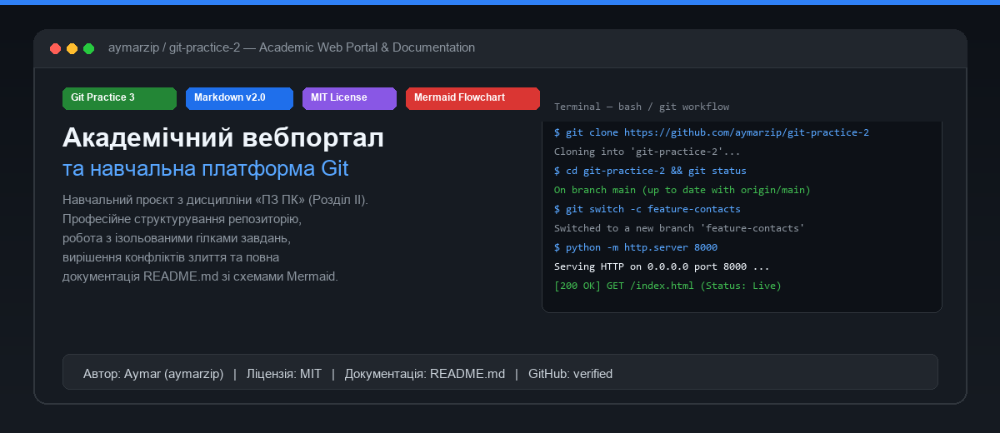
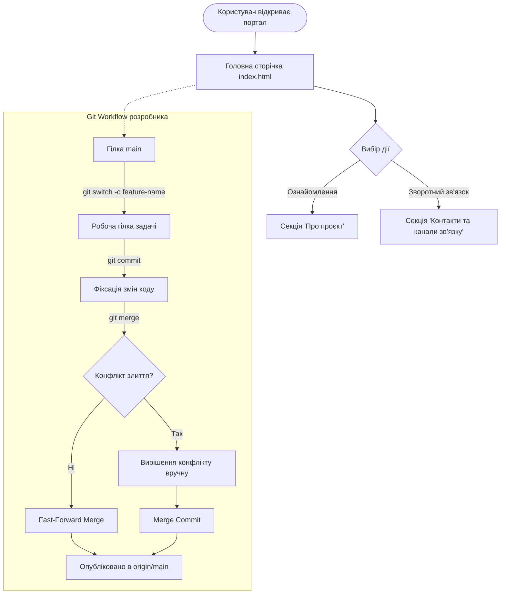

# Академічний вебпортал та навчальна платформа Git

[](https://github.com/aymarzip/git-practice-2)
[](https://github.com/aymarzip/git-practice-2)
[](LICENSE)
[](https://github.com/aymarzip/git-practice-2)

> **Академічний вебпортал комп'ютерних технологій** — це навчальний вебзастосунок, розроблений для опанування розподілених систем контролю версій Git, регламентів командної співпраці на GitHub, вирішення конфліктів злиття та професійного оформлення документації за стандартом CommonMark/GFM.

---

## 📸 Огляд проєкту



---

## 🎯 Про проєкт за 30 секунд

Цей репозиторій створено в межах навчальної дисципліни **«Програмне забезпечення ПК» (Розділ ІІ, Тема 2: «Markdown і документація проєкту»)**.

Головна мета проєкту — продемонструвати повний виробничий цикл роботи інженера:
1. **Ізольована розробка:** використання тематичних гілок завдань (`feature-branches`).
2. **Розв'язання конфліктів:** усвідомлене моделювання та усунення конфліктів злиття (`Merge Conflicts`).
3. **Еталонна документація:** структура `README.md`, яка забезпечує швидке занурення нового користувача або рецензента менш ніж за 30 секунд.

---

## ✨ Основні можливості (Features)

- **Семантична HTML5 верстка:** використання тегів `<header>`, `<main>`, `<section>`, `<footer>` для високої доступності та структурованості.
- **Модульні CSS3 стилі:** темна сучасна палітра, адаптивна типографіка, карткова композиція блоків.
- **Розділ контактів та зворотного зв'язку:** інтегрований блок зі списком комунікацій автора (`email`, `github`, `telegram`).
- **Повна історія розробки в Git:** чисті коміти з детальними повідомленнями за конвенцією Conventional Commits.
- **Вбудована архітектурна діаграма:** візуалізація життєвого циклу користувача за допомогою Mermaid.

---

## 📦 Встановлення (Installation)

Щоб отримати локальну копію проєкту та переглянути структуру, виконайте такі кроки у вашому терміналі:

```bash
# 1. Клонувати віддалений репозиторій через HTTPS
git clone https://github.com/aymarzip/git-practice-2.git

# 2. Перейти у кореневий каталог проєкту
cd git-practice-2

# 3. Перевірити стан гілки та робочого дерева
git status
```

> [!NOTE]
> Проєкт не потребує встановлення сторонніх пакетних менеджерів (`npm`, `pip`) для базового перегляду — весь вихідний код написаний на нативних вебтехнологіях (HTML5/CSS3).

---

## 🚀 Використання (Usage)

Ви можете відкрити вебпортал локально одним із таких способів:

### Спосіб 1. Вбудований HTTP-сервер Python (Рекомендовано)
Запустіть локальний сервер у кореневій папці репозиторію:

```bash
python -m http.server 8000
```
Після запуску відкрийте браузер за адресою: [http://localhost:8000](http://localhost:8000).

### Спосіб 2. Прямий запуск у браузері
У терміналі Windows PowerShell:
```powershell
Start-Process "index.html"
```

---

## 🛠 Технологічний стек та інструменти

| Технологія / Інструмент | Версія / Стандарт | Призначення в проєкті |
| :--- | :--- | :--- |
| **HTML5** | W3C Standard | Семантична структура та змістове наповнення сторінок |
| **CSS3** | Modern Layout | Модульна стилізація, кольорова схема та адаптивність |
| **Git** | 2.40+ | Розподілений контроль версій, управління гілками та злиття |
| **GitHub** | Cloud Platform | Віддалений хостинг коду, трекінг історії, рендеринг документації |
| **Markdown** | GFM / CommonMark | Професійне оформлення технічного опису та звітів |
| **Mermaid.js** | 10.0+ | Декларативна візуалізація архітектурних діаграм та потоків даних |

---

## 🗺 Архітектура взаємодії та Git Workflow

Нижче наведено схему життєвого циклу користувача на вебпорталі та процесу внесення змін у репозиторій:



---

## 📁 Структура проєкту

```text
git-practice-2/
├── assets/
│   └── preview.png         # Графічний банер-прев'ю проєкту для документації
├── css/
│   └── style.css           # Таблиця каскадних стилів (модульна верстка)
├── index.html              # Головна сторінка академічного вебпорталу
├── LICENSE                 # Офіційна відкрита ліцензія MIT
└── README.md               # Повна технічна документація репозиторію
```

---

## 📄 Ліцензія

Вихідний код та супровідні матеріали проєкту ліцензовано за умовами відкритої ліцензії **MIT License**.  
Повний текст умов використання розміщено у файлі [LICENSE](LICENSE).

---

## 👨‍💻 Автори та контакти

- **Автор проєкту:** студент Aymar
- **GitHub акаунт:** [@aymarzip](https://github.com/aymarzip)
- **Email:** `aymar@example.com`
- **Дисципліна:** «Програмне забезпечення ПК» (КН-2/1)
- **Навчальний заклад:** Фаховий коледж / Університет
